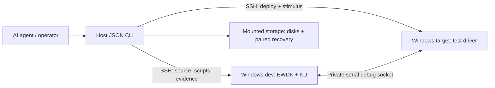

# Agent Kernel Lab

A headless, agent-friendly Windows kernel development lab on Linux/KVM. One Windows VM builds drivers and runs KD; a second runs test-signed drivers. The host provides a JSON command interface, SSH transport, console screenshots, isolated networking, evidence capture, and paired recovery.

**Status: v0.1.0 research preview.** The observable KMDF example was built, deployed, exercised and inspected in live KD on the original lab. The portable framework has host-side tests and XML validation; a fresh installation through this packaged release has not yet been completed. See [validation scope](docs/VALIDATION.md).

## What is included

- Configurable VM names, storage, resources, subnet and hash-pinned installation media.
- Windows 11 Pro x64 unattended setup, TPM 2.0, offline Microsoft-signed OpenSSH and per-instance credentials.
- Headless console and key-only SSH; no desktop viewer or agent-specific service required.
- A tested Echo-compatible KMDF build/sign/deploy profile with positive and negative IOCTL cases.
- Private symbols, serial KD, trace/breakpoint workflow, targeted Driver Verifier and dump-analysis helpers.
- Cold checkpoints and full backups that preserve disk, firmware, TPM and domain identity together.
- JSON results, dated evidence directories, a storage watchdog and next-agent handoffs.

The build environment also accepts other MSBuild driver projects through guest scripts. Automated packaging/deployment in v0.1 is specifically the Echo-compatible profile. ARM64, Hyper-V hosts, cloud VMs and arbitrary driver installers are outside this release's supported path.



## Start here

Use an x86-64 Linux host with KVM and a dedicated mounted ext4/XFS storage volume. The reference host is Ubuntu 22.04 with Python 3.10, libvirt 8.0 and QEMU 6.2. Plan for at least 32 GiB of host RAM. Defaults allocate 24 GiB of guest RAM and 230 GiB of virtual disks; provisioning requires at least 300 GiB free. More space is needed for full backups, dumps and checkpoint growth.

```sh
bash tools/install-host.sh
python3 akl.py init \
  --workspace "$HOME/.misc/akl-runtime" \
  --mount /mnt/lab \
  --storage /mnt/lab/.agent-kernel-lab \
  --lab-id akl --subnet 192.168.231.0/24
```

Choose a subnet that does not overlap host, VPN or other VM networks. `init` writes `local/lab.json`; it does not create a VM. Edit its three media entries using [the installation guide](docs/INSTALL.md) and [media.lock.json](media.lock.json). You supply the Windows/EWDK media and licenses. No Windows images, WDK binaries, SSH private keys or personal runtime state are distributed.

```sh
python3 akl.py media-verify
sudo python3 akl.py doctor
sudo python3 akl.py provision --accept-windows-eula
```

Continue with [installation and configuration](docs/INSTALL.md), then [the development workflow](docs/WORKFLOW.md). Agents should read [AGENTS.md](AGENTS.md) first. Do not run `provision` against an existing lab; this release does not import older installations.

## Daily commands

```sh
sudo python3 akl.py status
# Keep this in a separate supervised terminal during VM operation:
sudo python3 akl.py watch
# In another terminal:
sudo python3 akl.py start
python3 akl.py cycle --deploy
python3 akl.py debug
```

`cycle` writes source hashes, build/deploy/probe logs, a signed package, PDB and `result.json` under the configured workspace's `runs/` directory. `debug` is an interactive terminal exception to the normal JSON interface. Follow the debugger detach instructions before stopping.

```sh
sudo python3 akl.py stop
sudo python3 akl.py checkpoint create my-baseline
sudo python3 akl.py handoff --note 'Describe current experiment, evidence and next action'
```

## Validate and package

```sh
python3 -m unittest discover -s tests -v
python3 tools/release.py
```

The deterministic source archive and SHA256 sidecar appear in `dist/`. A strict publication allowlist excludes local configuration, credentials, VM media, binaries, dumps, logs and generated evidence. The archive includes an internal SHA256 manifest. CI also parses rendered PowerShell helpers on Windows; it does not silently provision licensed VMs.

Framework code is [MIT licensed](LICENSE). The included Microsoft-derived Echo sample retains [MS-PL](examples/observable-echo/LICENSE); see [third-party notices](THIRD_PARTY_NOTICES.md).
